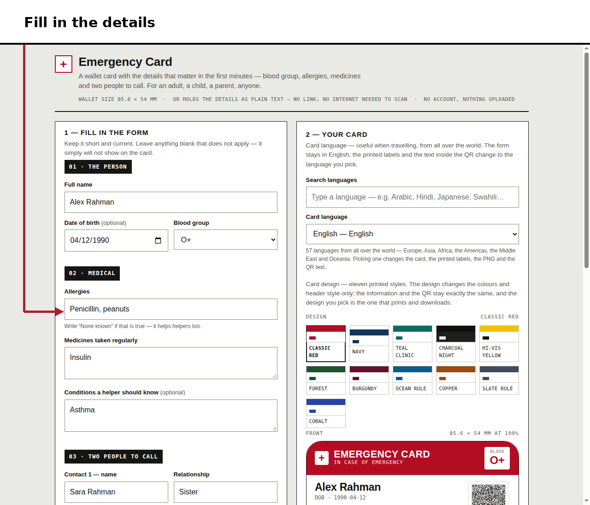
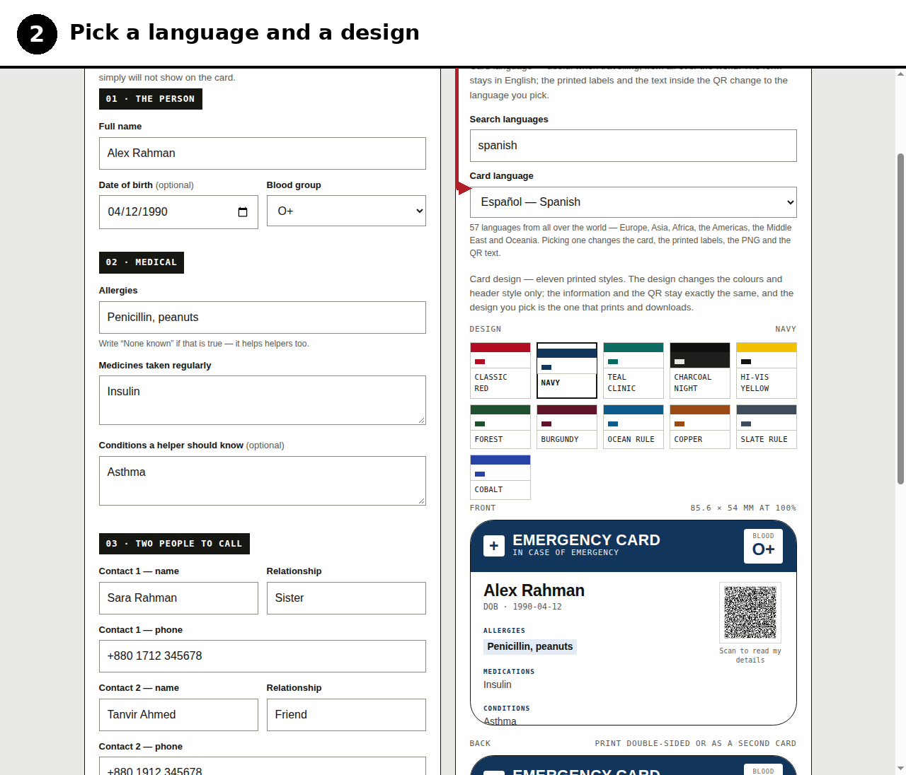
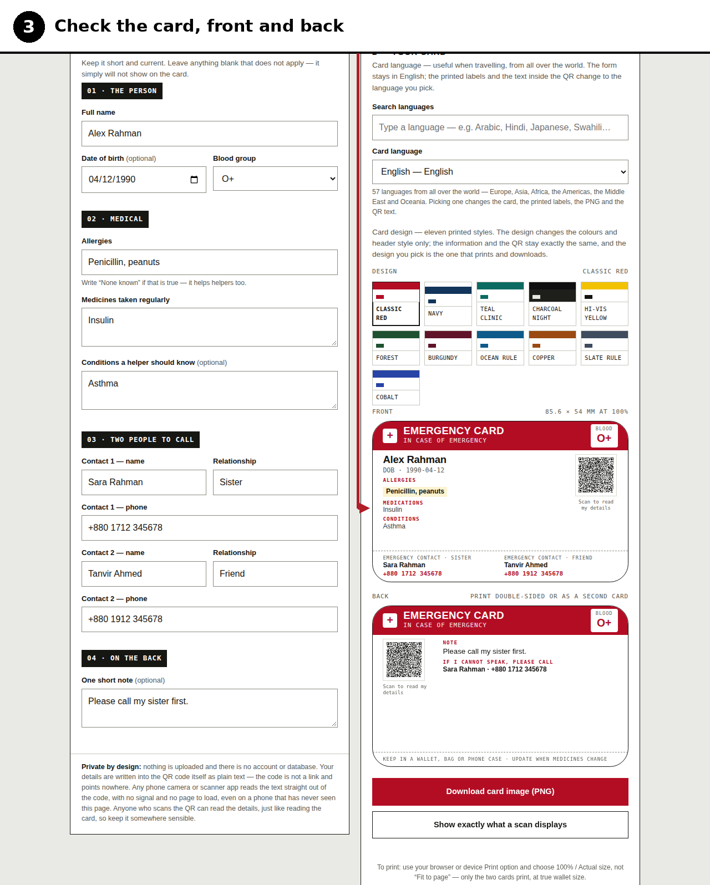
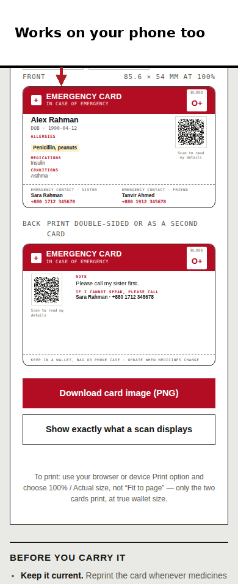
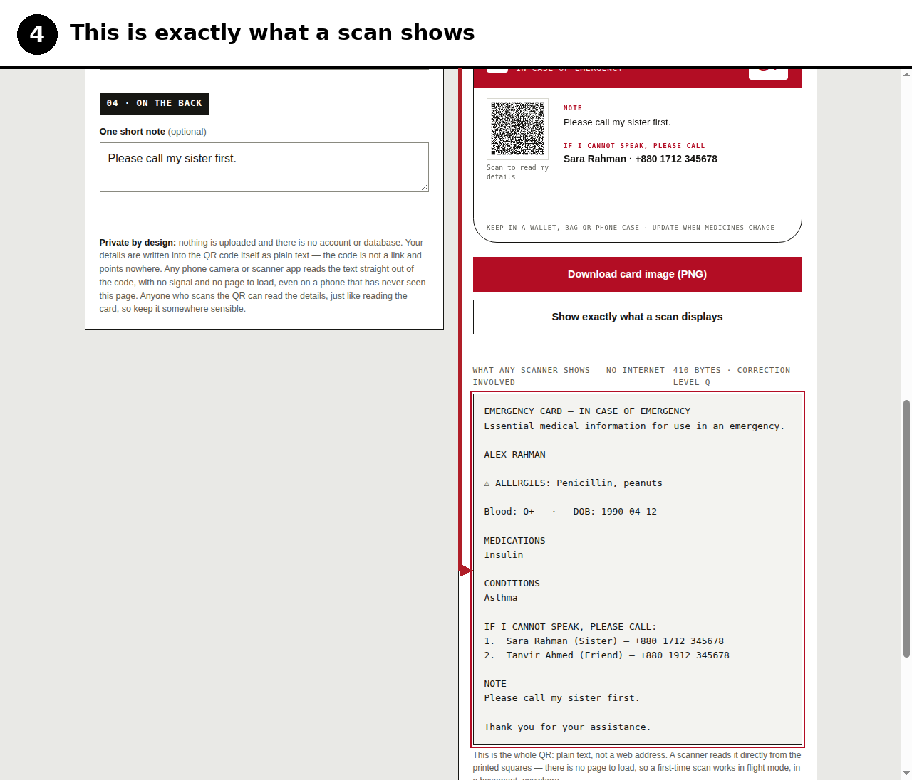
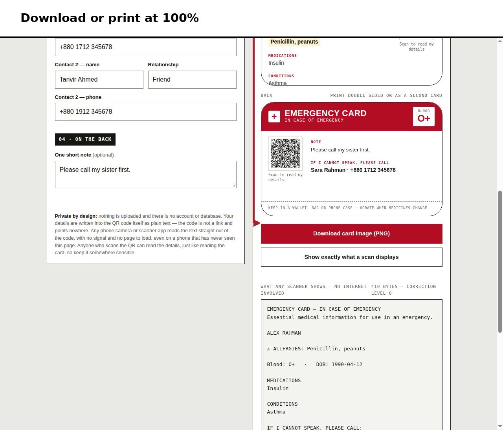

# Emergency Card

A printable wallet card that carries the medical details a stranger would need if you cannot speak for yourself.

Fill in the form, print the card, put it in your wallet. Scan the QR code and the details are there as plain text — no app of ours, no account, no internet needed at scan time.

Live version: https://siamspectrum.github.io/emergency-card/

## What it is

- Wallet size: 85.6 × 54 mm, front and back.
- Fields: name, date of birth, blood group, allergies, medicines taken regularly, conditions a helper should know, two emergency contacts, and a note.
- The QR code holds the details as text. Any modern phone camera or scanner app can read it. It does not link to a website.
- 57 languages for the printed labels and the QR text. Arabic, Persian, Hebrew and Urdu display right-to-left.
- 11 card designs. The design you pick is what prints and what the PNG download renders.
- Print and PNG download are built in.

## Privacy

Nothing you type is uploaded or saved anywhere. There is no server, no database, and no account. The page is a single HTML file. Your details stay in your browser tab and in the QR code you print. The page loads its fonts from Google Fonts; your details are not in that request.

## How to use it

The screenshots below use fictional sample details (Alex Rahman, allergy to penicillin and peanuts). They are not a real person's records.

### 1. Open the page

Open the live site, or download `index.html` and open it in any browser — PC, Android, iPhone. There is nothing to install and no sign-up.

### 2. Fill in the form

Type your name, date of birth, blood group, allergies, medicines taken regularly, conditions a helper should know, two emergency contacts, and a short note. Keep it short and current. Leave blank anything that does not apply — it will not show on the card. If you have no known allergies, write "None known"; that helps a helper too.

### 3. Pick a language and a design

Search the 57 languages and pick the one a helper where you are is most likely to read — the printed labels and the text inside the QR change to it. Then pick one of the 11 card designs. The design changes the colours and header only; the information and the QR stay exactly the same.

### 4. Check the card

The preview shows the card front and back at wallet size, 85.6 × 54 mm. Check the name, blood group and allergies are right, and that nothing is cut off. The back carries the second QR, the note, and the first person to call.

On a phone the same preview stacks into one column:

### 5. Check exactly what a scan shows

Click "Show exactly what a scan displays". This is the whole QR: plain text, not a web address. It starts with the name in capitals and the allergies, then blood group, date of birth, medicines, conditions, the two contacts, and the note. Any modern phone camera or scanner app reads it straight from the printed squares — no signal, no page to load, even on a phone that has never opened this page.

### 6. Download or print it

Click "Download card image (PNG)" for an image of the card, or print from your browser or device: choose the Print option and set 100% / Actual size, not "Fit to page" — only the two cards print, at true wallet size. Print double-sided, or print the back as a second card and stick the two together.

### 7. Test it, then carry it

Before you carry the card, scan the printed card once with the phone in flight mode. If it reads with no signal, it will read in an emergency. Then keep it in your wallet, bag or phone case.

That is all. No install, no sign-up.

## Before you carry it

Reprint the card when medicines or phone numbers change — an old card can mislead. Scan the printed card once, in flight mode, to prove it reads with no signal. This is not medical advice and does not replace an official medical ID.

## Run it yourself

Download `index.html` and open it in a browser. It works from a local file; the fonts fall back to system fonts when you are offline. To host it, serve the same file from any static host.

## Contributing

Found a wrong translation or a design that prints badly? Open an issue saying which language or design, and what it should say. Keep changes small and keep the page working offline. If a translation is wrong, correct that language only and say how you know.

## License

MIT. See `LICENSE`.
